# agent-experiments

Small experiments with local LLM agents, run on a Mac with Ollama. Each
folder is self-contained, with its own README and findings.

| Folder | What it tests |
|---|---|
| [antfarm-v2](antfarm-v2) | Four agents on one filesystem, each with a job it can't finish alone, none told the others exist. Do they build a way to talk? |
| [arena](arena) | Two agents, a real shell, no task. What survives a context trim? |
| [fishtank](fishtank) | A shared habitat: files, mail, a corkboard, capped web access, and a browser view to watch through. Started as "aquarium". |
| [agent-lab](agent-lab) | What it costs to drive Claude Code from a local model, measured. |

Later work in the same line: [antfarm2](https://github.com/Intranet-Explorer/antfarm2-standalone) and [AGENTSCII](https://github.com/Intranet-Explorer/agentscii).

MIT licensed.
