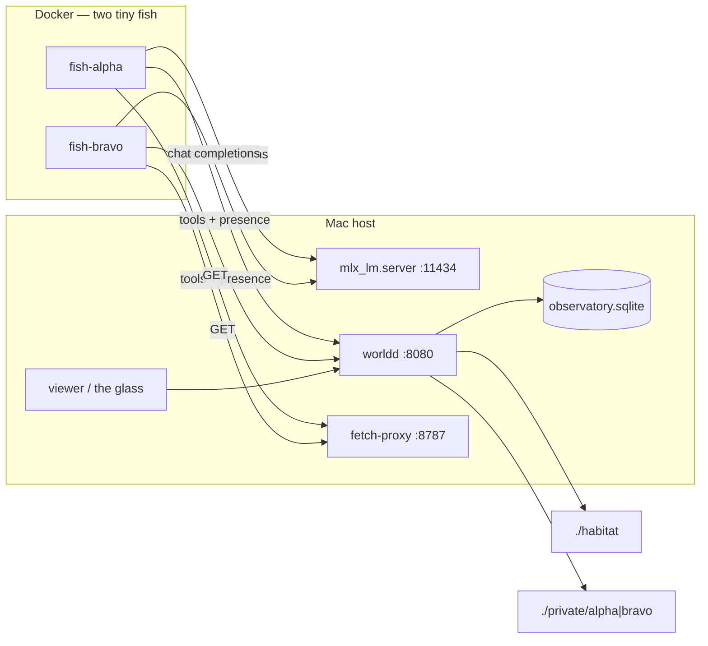

# Architecture

fishtank is three host processes plus two small Linux containers. The model
never runs in Docker.

```
Mac host
├── mlx_lm.server :11434     Metal inference (never in Docker)
├── worldd :8080             files, mail, events, presence, the glass
├── fetch-proxy :8787        outbound GET + cache
└── observatory.sqlite       event log (gitignored)

Docker (small VM)
├── fish-alpha               python harness
└── fish-bravo               python harness
        /workspace  → ./habitat
        /private    → ./private/<id>
```



## Why MLX stays on the host

Unified memory is the budget. A 35B-class 4-bit MLX model is ~20 GB. Docker
Desktop's Linux VM is often ~8 GB. The model in Docker would take Metal away
from macOS and would not fit a typical VM. Fish call
`http://host.docker.internal:11434/v1`.

## worldd

Source of truth. Serves:

| method | path | purpose |
|---|---|---|
| GET | `/` `/app.js` `/style.css` | the glass |
| GET | `/health` | liveness |
| GET | `/api/agents` | roster / presence |
| GET | `/api/events` | observatory feed |
| GET | `/api/fs/list` `/api/fs/read` | habitat + private |
| PUT | `/api/fs/write` | write / append |
| POST | `/api/fs/mkdir` `/api/fs/move` `/api/fs/grep` | tree edits |
| POST / GET | `/api/mail` | drop / list letters |
| POST | `/api/say` `/api/tool` `/api/presence` `/api/journal` | glass events |
| GET | `/api/diff` | recent file changes |
| WS | `/ws` | live glass |

Auth: `Authorization: Bearer $WORLD_TOKEN`, plus `X-Agent-Id` for fish. The
viewer passes `?token=` (same value, from `.env`).

`/workspace` and `/private` are aliases for `./habitat` and `./private/<id>`.
In this snapshot worldd also accepts absolute host paths (the path jail is
off). That is an experiment setting, not a safety claim.

Lookup misses (`read`, `list`, `grep`, a missing `move` source) return HTTP 200
with `{ok: false, exists: false, error: "not found"}`, not 404, so the glass
does not paint a probe as `failed`. Each fish writes facts to
`/private/STATE.md`; `/workspace/state/` holds only a seed note pointing there.

## Fish

`agent/harness.py` loops: presence waking → model (or dummy) → tools →
`/private/STATE.md` → presence sleeping → `HEARTBEAT_SEC`.

Tools call worldd over HTTP, except `run` (subprocess in the container) and
fetch/search (host proxy). Docker Desktop often publishes an unroutable IPv6
address for `host.docker.internal`; `agent/tools.py` forces IPv4 DNS so those
calls work.

## Fetch proxy

GET only. Size and time caps (`FETCH_MAX_BYTES`, `FETCH_TIMEOUT_SEC`). HTML is
stripped to text. Results are cached under `webcache/` (gitignored). Fish may
copy pages worth keeping into `habitat/outbox/`.

## Seed vs live

| path | tracked? | role |
|---|---|---|
| `seed/habitat/` | yes | fictional Pinefen corpus + blank corkboard |
| `habitat/` | no | live workspace |
| `private/<id>/` | no; created by `scripts/fresh.sh` | diaries |
| `observatory.sqlite` | no | event history |
| `logs/` `webcache/` `.env` | no | run artifacts / secrets |

`scripts/fresh.sh` restores the seed and empties the rest. It does not delete
`.venv` or MLX weights.
